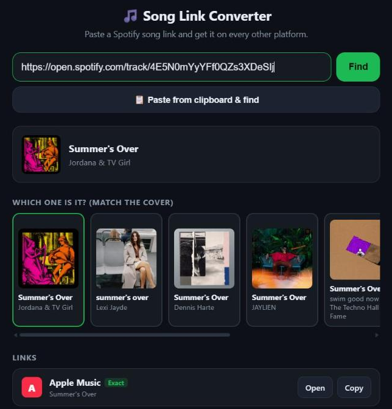

# 🎵 Song Link Converter

**Paste a Spotify song link and get the same song on Apple Music, SoundCloud, Amazon Music, YouTube Music, Tidal and Deezer, each with a one-tap Copy button.**

### ▶ [Try it live](https://zachariahmcgovern.github.io/song-link/)

<p align="center">
  
</p>

---

## Why

Friends don't all use the same music app. When someone sends a Spotify link and you use Apple Music or SoundCloud, finding the same song by hand is tedious. This tool does it in one paste.

## Features

- **Exact Apple Music links.** Finds the specific track, not just a search page.
- **SoundCloud, Amazon Music, YouTube Music, YouTube, Tidal and Deezer.** One tap opens each app's search for the song and artist.
- **Version picker.** When several songs share a title, it shows their covers so you can tap the right one.
- **One-tap copy** for every link, plus a universal [song.link](https://song.link) link that covers all platforms.
- **Works like an app.** Add it to your phone's home screen and it opens full-screen with its own icon.
- **No backend, no account, no API keys.** It's a static page that runs entirely in the browser.

## How it works

```
Spotify link ──► Spotify oEmbed API ──► title + cover art
                                              │
                                              ▼
                                    iTunes Search API ──► Apple Music matches (+ artist)
                                              │
                                              ▼
                       Build links: Apple Music (exact) · SoundCloud, Amazon, YouTube,
                                    Tidal, Deezer (search) · song.link (all platforms)
```

1. **Parse the link.** Pulls the track ID out of the Spotify URL, ignoring tracking parameters like `?si=`.
2. **Get song details.** Calls Spotify's public [oEmbed endpoint](https://developer.spotify.com/documentation/embeds/reference/oembed) for the title and cover art.
3. **Find it on Apple Music.** Searches the [iTunes Search API](https://performance-partners.apple.com/search-api) by title, keeps exact title matches, and uses the chosen match's artist name.
4. **Build the links.** Uses the exact Apple Music URL, plus search URLs on the other platforms for `title + artist`.

Both APIs are free, need no key, and allow browser requests (CORS), which is why the app needs no server.

### Why are some links "Search" instead of "Exact"?

SoundCloud, Amazon Music, YouTube Music, Tidal and Deezer either require API keys or block requests from web pages, so a static site can't look up their track IDs. Linking to their search for "title artist" is the most reliable option. The right song is almost always the first result.

## Project structure

```
song-link/
├── index.html            # Page markup
├── css/
│   └── style.css         # Styles (dark theme, mobile-first)
├── js/
│   └── app.js            # All app logic: parsing, API calls, rendering
├── assets/
│   └── icons/            # Home-screen / favicon icons
├── docs/
│   └── screenshot.png    # Image used in this README
├── manifest.json         # Web app manifest (name, icon, standalone display)
├── LICENSE
└── README.md
```

## Use it on your phone

| iPhone (Safari) | Android (Chrome) |
| --- | --- |
| Open the [live site](https://zachariahmcgovern.github.io/song-link/) → **Share** → **Add to Home Screen** | Open the [live site](https://zachariahmcgovern.github.io/song-link/) → **⋮** menu → **Add to Home screen** |

## Run it locally

There's no build step. Clone the repo and serve the folder:

```bash
git clone https://github.com/ZachariahMcGovern/song-link.git
cd song-link
python3 -m http.server 8000
```

Then open <http://localhost:8000>.

## Deployment

The site is hosted on **GitHub Pages** from the `main` branch (root folder). Any push to `main` redeploys it automatically within a minute or two.

## Limitations

- Only **Spotify track** links are supported as input (not playlists, albums or artists).
- Apple Music matching is by title, so very common titles may show several covers to choose from.
- Apple Music results use the US storefront.

## Ideas for later

- Accept Apple Music links as input too (reverse direction)
- Album support
- A share button that sends all links at once

## Tech

Plain HTML, CSS and JavaScript. No frameworks or dependencies.

## License

[MIT](LICENSE) © 2026 Zachariah McGovern
